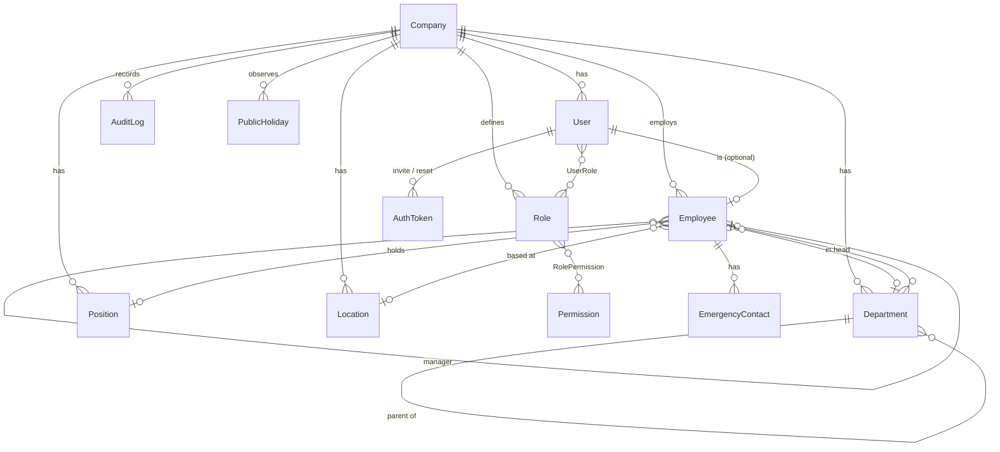
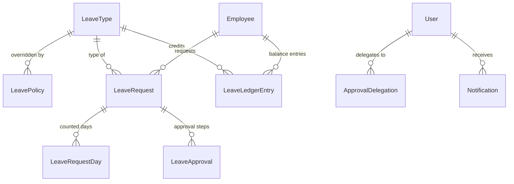

# HRMS — Architecture

Employee Management Portal for UAE-based companies. This document is the source of truth for the
stack, structure, data model and access model. It is updated at every checkpoint.

## 1. Stack

| Concern            | Choice                                                                    | Notes |
|--------------------|---------------------------------------------------------------------------|-------|
| Framework          | Next.js 15 (App Router), React 19, TypeScript `strict`                     | Server Components for reads, Server Actions for mutations |
| Database           | PostgreSQL 16 + Prisma 6 (migrations + seed)                               | Prisma 6 chosen over 7/8 (still RC / breaking config changes) |
| Auth               | Auth.js v5 (`next-auth@5` beta): Credentials + optional Google / Microsoft Entra ID | see §6 for the session model |
| Password hashing   | `bcryptjs` (cost 12)                                                       | pure JS: no native build step in Docker/CI |
| UI                 | Tailwind CSS v4 + shadcn/ui components (Radix primitives), `next-themes`   | components vendored in `src/components/ui` |
| Validation         | Zod 4 — every Server Action / route handler parses its input               | schemas in `src/lib/validation` shared with forms |
| i18n               | `next-intl` (no locale routing; locale from cookie + saved `User.locale`) + `dir` on `<html>` | English + Arabic (RTL); see docs/I18N.md |
| Jobs / cron        | `pg-boss` (Postgres-backed, no Redis) in a separate `worker` process       | |
| Email              | Nodemailer; `EMAIL_TRANSPORT=console` logs in dev, `smtp` → Mailpit/real SMTP | templates in `src/server/mail/templates` |
| PDF (Phase 3)      | `@react-pdf/renderer` (no headless browser needed in production image)     | |
| Tests              | Vitest (unit), Playwright (e2e)                                            | |
| Local dev          | Postgres 16 + Mailpit in Docker (`docker-compose.yml`); app and worker run natively (`next dev --turbopack`) | |
| Production test    | `docker-compose.prod.yml`: multi-stage image (`next build`, standalone production server), migrate job, worker, Postgres, Mailpit | |

### Deviations from the brief
* **Session strategy.** Auth.js cannot persist database sessions for the Credentials provider. We use
  Auth.js' encrypted (JWE) session cookie, and make it behave like a server session:
  every request re-loads the user from the DB (`getAuthContext`) and rejects the session if the user is
  inactive/terminated or if `user.sessionVersion` no longer matches the cookie (bumped on logout-all,
  password change, role change, termination). Idle timeout = `SESSION_IDLE_MINUTES` (rolling cookie),
  absolute timeout = `SESSION_ABSOLUTE_HOURS`.
* **bcrypt instead of argon2**: avoids native modules; cost factor is configurable.
* **Login is by globally-unique email.** A user belongs to exactly one company. Multi-company users would
  need a company picker; out of scope.
* **shadcn/ui components are vendored by hand** in `src/components/ui` (same API/styling as the CLI output);
  form selects use a styled native `<select>` for accessibility and plain `FormData` submission.
* **Next.js 15 / Prisma 6** are pinned rather than the newest majors, which were still RC or had breaking
  configuration changes at the time of writing.

### Theming
`src/theme/brand.ts` holds the palette and the light/dark semantic tokens. The root layout injects them as CSS
variables (`brandCss()`), and `globals.css` maps them to Tailwind utilities (`bg-primary`, `text-link`,
`bg-sidebar` …). The PDF and email renderers import the same values. Dark surfaces inside the light theme
(the sidebar, the dark header and the login panel) use the `.dark` class, so their components pick up the
dark tokens. `tests/unit/brand-contrast.test.ts` enforces WCAG AA on every token pair.

## 2. Folder structure

```
prisma/
  schema.prisma          # data model
  migrations/            # generated SQL migrations (committed)
  seed.ts                # demo company, roles/permissions, ~40 employees
  seed-data/             # deterministic seed fixtures
messages/<locale>/<ns>.json  # i18n strings (en, ar), one file per namespace
src/
  app/
    (auth)/              # login, forgot/reset password, invite acceptance, forced password change
    (app)/               # authenticated shell (sidebar + topbar)
      dashboard/ directory/ org-chart/ profile/
      employees/         # list, new, import, [id] (tabbed detail), [id]/edit, [id]/terminate
      organization/      # departments, positions, locations
      admin/             # roles, users, audit, company settings
    api/
      auth/[...nextauth] # Auth.js
      files/             # authenticated file streaming (photos, logos)
      employees/export   # CSV export
  components/
    ui/                  # shadcn/ui primitives
    layout/              # app shell, nav, theme toggle
    data-table/          # URL-driven table: search, sort, filters, pagination
    ...feature components
  lib/                   # isomorphic helpers: validation schemas, iban, masking, dates, money, cn()
  server/                # server-only code (imports `server-only`)
    db.ts                # Prisma client singleton
    auth/                # Auth.js config, password, tokens, rate limit, getAuthContext
    rbac/                # permission catalogue, role defaults, authorize helpers, team scope
    services/            # business logic (one file per aggregate); NO request objects here
    actions/             # thin Server Actions: parse (Zod) → authorize → service → revalidate
    audit.ts             # writeAudit()
    mail/                # mailer + templates
    storage/             # pluggable file storage (local disk now, S3 later)
    jobs/                # pg-boss queue definitions + handlers
  worker.ts              # job runner entrypoint
  i18n/                  # next-intl request config
tests/
  unit/                  # Vitest
  e2e/                   # Playwright
docs/                    # ARCHITECTURE.md, CHANGELOG.md
```

**Layering rule:** `page.tsx` / Server Actions / route handlers are thin. They call
`getAuthContext()` → `authorize()` → a service function that receives the `AuthContext` and validated
input. Services always filter by `ctx.companyId`. Client components never import from `src/server`.

## 3. Data model (Phase 1)



Key tables (see `prisma/schema.prisma` for every column):

| Table | Purpose / notable columns |
|-------|---------------------------|
| `Company` | name, logo, address, `currency` (ISO, default AED), `timezone` (default Asia/Dubai), `workWeek` (int[] ISO weekday 1=Mon…7=Sun, default 1–5), `fiscalYearStartMonth`, employee-number prefix/padding/sequence |
| `User` | login identity: email (unique), `passwordHash` (null until invite accepted), `mustChangePassword`, `isActive`, `sessionVersion`, `lastLoginAt` |
| `Role`, `Permission`, `RolePermission`, `UserRole` | DB-stored RBAC. Permissions are a global catalogue; roles are per company |
| `AuthToken` | hashed (SHA-256) single-use tokens: `INVITE`, `PASSWORD_RESET` with expiry |
| `LoginAttempt` | rate-limit + security trail (email, ip, success, time) |
| `Department` | self-referencing `parentId` (unlimited depth), `headId` → Employee, `costCenterCode` |
| `Position` | title, code, `grade`, `level` |
| `Location` | branches / sites |
| `Employee` | HR record (see brief), self-referencing `managerId`, `status` (ACTIVE / ON_LEAVE / TERMINATED), UAE identity docs, bank/IBAN, termination fields. Never hard-deleted |
| `EmergencyContact` | 0..n per employee |
| `AuditLog` | actor, action, entity, entityId, `before`/`after` JSON, ip, user agent |
| `PublicHoliday` | per company/year, optional location; managed in Leave → Settings |

Conventions:
* Every business table carries `companyId` (indexed) — single company today, never hard-coded.
* IDs are `cuid`. Timestamps are `timestamptz` in UTC. **Calendar dates** (DOB, join date, expiries,
  last working day) are `date` columns — they are not instants and must not shift with timezones.
* Money (Phase 3) will be `BigInt` minor units (fils) + company currency. Never float.
* Cycles: `Employee.managerId` and `Department.parentId` are validated in the service layer
  (walk the ancestor chain with a recursive CTE before writing).

## 4. Roles & permission matrix

Permissions are rows in `Permission`; seeded roles get the defaults below and are editable from
**Admin → Roles** (the system `SUPER_ADMIN` role is locked so nobody can lock themselves out).
A user can hold several roles; effective permissions are the union.

| Permission key | Super Admin | HR Admin | Payroll Admin | Manager | Employee |
|---|:-:|:-:|:-:|:-:|:-:|
| `company.settings.manage` | ✅ | | | | |
| `role.manage` | ✅ | | | | |
| `user.manage` (invite, reset, deactivate, assign roles) | ✅ | ✅ | | | |
| `audit.read` | ✅ | ✅ | | | |
| `org.manage` (departments, positions, locations) | ✅ | ✅ | | | |
| `employee.read.all` | ✅ | ✅ | ✅ | | |
| `employee.read.team` (direct + indirect reports) | ✅ | ✅ | | ✅ | |
| `employee.create` / `employee.update` | ✅ | ✅ | | | |
| `employee.terminate` | ✅ | ✅ | | | |
| `employee.import` | ✅ | ✅ | | | |
| `employee.export` | ✅ | ✅ | ✅ | | |
| `employee.sensitive.read` (IDs, passport, visa, IBAN unmasked) | ✅ | ✅ | ✅ | | |
| `directory.read` / `orgchart.read` | ✅ | ✅ | ✅ | ✅ | ✅ |
| `dashboard.hr` | ✅ | ✅ | | | |
| `leave.config.manage` (leave types, policies, holidays, leave settings) | ✅ | ✅ | | | |
| `leave.request.read.all` (all requests, company calendar) | ✅ | ✅ | | | |
| `leave.approve.team` (approve direct + indirect reports) | ✅ | ✅ | | ✅ | |
| `leave.approve.all` (act on any step, incl. HR steps) | ✅ | ✅ | | | |
| `leave.balance.adjust` (manual adjustment, reason required) | ✅ | ✅ | | | |
| `leave.report.read` (reports, balance exports) | ✅ | ✅ | ✅ | | |
| `payroll.settings.manage` (pay components, proration, WPS, gratuity rules) | ✅ | | ✅ | | |
| `payroll.salary.read` / `payroll.salary.manage` (salary structures, adjustments) | ✅ | | ✅ | | |
| `payroll.run.manage` (create, calculate, hold, submit, release, cancel) | ✅ | | ✅ | | |
| `payroll.run.approve` (checker — never the run's maker) | ✅ | | ✅ | | |
| `payroll.run.reopen` (unlock a released run, reason required) | ✅ | | | | |
| `payroll.export` (register, WPS SIF, bank file) | ✅ | | ✅ | | |
| `payslip.read.all` | ✅ | | ✅ | | |
| `payroll.settlement.manage` (final settlements; approver ≠ preparer) | ✅ | | ✅ | | |
| *Self-service* (own profile, own leave, own payslips) | implicit for any user linked to an employee | | | | |

Rules on role assignment (`user.manage`): only a Super Admin can grant/revoke Super Admin or
enable/disable a Super Admin; at least one active Super Admin must remain; non-Super-Admins cannot
change their own roles and can only grant roles whose permissions they already hold. A Manager role is
granted automatically when someone becomes the manager of an employee (never revoked automatically).

Data visible per relationship to an employee record:

| Viewer | Personal data | ID / passport / visa / IBAN | Emergency contacts | Tabs |
|---|---|---|---|---|
| Self | full | unmasked | yes (editable) | Overview, Job, Documents, Leave, Payroll |
| `employee.read.all` + `employee.sensitive.read` | full | unmasked | yes | all |
| `employee.read.all` only | full | masked | yes | Overview, Job, Documents, Leave |
| Manager (team member) | DOB/personal email/address hidden | masked | hidden | Overview, Job, Leave |
| Anyone else | directory card only (name, title, department, location, work email, manager) | — | — | — |

Enforcement:
1. **Server first.** Every Server Action, route handler and page loader calls
   `authorize(ctx, permission)` or a scoped check (`canViewEmployee(ctx, employeeId)` combines
   `employee.read.all`, `employee.read.team` + reporting-tree membership, and self).
2. **Data shaping.** Services return DTOs per audience — the directory DTO has no sensitive columns;
   sensitive columns are selected only when `employee.sensitive.read` is held, and are masked in lists.
3. The UI hides what the user cannot do, purely as UX.

## 5. Audit

`writeAudit(ctx, { action, entityType, entityId, before, after })` inside the same transaction as the
change, capturing IP / user agent from request headers. Audited: employees (create/update/terminate/import),
users & role assignments, roles/permissions, company settings, departments/positions/locations, and —
later — salary, leave approvals and payroll. Secrets (password hashes, token hashes) are stripped.

## 6. Authentication & sessions

* Credentials login (bcrypt) with rate limiting: max 5 failures / 15 min per email and 20 / 15 min per IP
  (DB-backed `LoginAttempt`, works across instances).
* Optional Google and Microsoft Entra ID providers, enabled only when their env vars are set. SSO only
  signs in **existing** users matched by verified email (no self-provisioning).
* Invite flow: HR creates employee → optional "send invite" → single-use token (72h) → set password.
* Forgot/reset: token valid 1h; response never reveals whether the email exists.
* First-login forced password change via `mustChangePassword` (enforced in the app layout and in
  `getAuthContext` for every action).
* Termination: when `lastWorkingDay` (company timezone) has passed, login is refused and existing
  sessions are invalidated; a daily job flips scheduled terminations to `TERMINATED`.

## 7. Security baseline

* Secure headers (CSP, HSTS in prod, X-Frame-Options DENY, nosniff, Referrer-Policy, Permissions-Policy)
  in `next.config.ts`.
* CSRF: Server Actions are POST-only with Next's built-in Origin/Host check; Auth.js routes use its CSRF
  token; our mutating route handlers verify `Origin`.
* Uploads: type sniffed from magic bytes (not the client MIME), size limits, random file names, stored
  outside `public/`, streamed through an authorised route.
* IBAN / Emirates ID / passport masked in lists and for non-privileged viewers.

## 8. Background jobs (pg-boss)

All handlers are idempotent (ledger rows carry unique period keys), so a missed run is caught up by the next.
Schedules are in `JOBS_TIMEZONE` (default Asia/Dubai). Registry: `src/server/jobs/index.ts`.

| Queue | Schedule | What it does | Phase |
|---|---|---|---|
| `employee-apply-terminations` | daily 00:15 | flips due terminations to TERMINATED, disables login | 1 |
| `leave-year-end` | 1 Jan 00:05 | closes last year: carry forward up to the cap (with expiry), lapse the rest | 2 |
| `leave-monthly-accrual` | 1st of month 00:20 | credits monthly accruals / yearly entitlements | 2 |
| `leave-daily` | daily 00:30 | expires unused carried-forward days, syncs ACTIVE ↔ ON_LEAVE, accrual catch-up | 2 |
| `leave-escalations` | weekdays 08:00 | reminds approvers after N days; second reminder escalates manager steps to HR | 2 |
| `notifications-email` | every 5 min | retries queued notification emails (outbox) | 2 |
| `documents-expiry-alerts` | daily | 60/30/7-day alerts | 4 |

Payroll has no scheduled job: runs are started by people. Release sends payslip notifications through the
same email outbox.

## 9. Leave management (Phase 2)

### Data model



| Table | Purpose |
|---|---|
| `LeaveType` | every rule is data: entitlement, accrual method (UPFRONT / MONTHLY / NONE), eligibility after N months, pro-rating, carry-forward cap + expiry, max days per request, document threshold, notice, half days, negative balance, gender, weekends/holidays counted, approval chain (`["MANAGER","HR"]`), paid flag |
| `LeavePolicy` | overrides entitlement/eligibility by department, position and/or employment type — most specific wins |
| `LeaveLedgerEntry` | every credit/debit that is not leave taken: ENTITLEMENT, ACCRUAL, CARRY_FORWARD, CARRY_OUT, LAPSE, CARRY_FORWARD_EXPIRY, ADJUSTMENT. System entries have a unique `periodKey` (e.g. `acc-2026-03`) → idempotent jobs |
| `LeaveRequest` | dates, half day (single-day only), status, current step, attachment, cancellation reason |
| `LeaveRequestDay` | one row per counted day (1 or 0.5). The single source for balances per year, overlaps, calendars, reports and payroll's unpaid-leave deduction |
| `LeaveApproval` | one row per step (REQUEST or CANCELLATION kind) with assignee, decision, actor, *on behalf of* (delegation), comment, reminder timestamps |
| `ApprovalDelegation` | delegator → delegate for a date range |
| `Notification` | in-app notification **and** email outbox (`emailStatus` PENDING → SENT/FAILED, retried by the worker) |

### Rules engine (pure, unit-tested: `src/lib/leave/*`)

* **Day counting** — a date counts if it is a working day (company work week) or the type counts weekends,
  and it is not a public holiday (company-wide or the employee's location) or the type counts holidays.
  Half days only for single-day requests. Cross-year requests are split per year.
* **Balance** = accrued + carried forward + adjustments − expired − carried out − taken − pending, per
  calendar year. Taken/pending come from request days, so cancelling a request releases the days instantly.
* **Accrual** — MONTHLY credits entitlement/12 per month of eligible service (pro-rated by days for the month
  eligibility starts or employment ends) once the month has ended. UPFRONT credits the year's entitlement on
  1 Jan or on the eligibility date (optionally pro-rated). Months before eligibility do not accrue.
* **Booking ahead** — the balance check includes credits that will have accrued by the leave date and, for
  next year, the days that will carry forward (capped). Already-credited entries are never recomputed.
* **Year end** — remaining ≤ cap carries forward with an expiry date; the rest lapses; negative balances
  carry in full. Carried days are consumed first (FIFO) and anything unused lapses at expiry.

### Workflow

1. Submit → validate (eligibility, notice/backdating ≤ 30 days, overlaps, max days, document, balance) inside a
   transaction guarded by a per-employee advisory lock; create day rows and one approval row per step.
   A MANAGER step resolves to the line manager; with no manager it is skipped if an HR step follows, otherwise
   HR handles it. No steps → auto-approved.
2. Each decision uses an optimistic lock (`decision = PENDING`) so two approvers can't both act. Rejection
   needs a comment. Requesters can never decide their own leave, even with `leave.approve.all`.
3. Who can act: the assigned manager, an active delegate of that manager, or anyone with
   `leave.approve.all`.
4. Cancellation: pending → employee withdraws; approved & not yet ended → employee requests cancellation
   (days stay booked) → manager/HR decides; HR can also cancel directly with a reason.
5. Every step notifies the requester and the next approvers (in-app + email) and is audited.

### Privacy

The team calendar for employees shows colleagues only as "On leave" (no leave type); teammate warnings on
the apply form show names and dates only. Managers see types for their reports; HR sees everything.

## 10. Payroll (Phase 3)

### Data model
* `PayComponent`: code, earning/deduction, fixed or **formula** (e.g. `BASIC * 0.5`), monthly or one-time,
  taxable flag, WPS fixed/variable flag, system flag. Defaults: Basic, Housing (= 50% of basic), Transport,
  Other allowance, Overtime, Bonus, Reimbursement; Unpaid leave, Loan/advance, Other deduction.
* `SalaryStructure` + lines: **effective-dated and append-only** (`@@unique(employeeId, effectiveFrom)`);
  only future-dated structures can be deleted. Formula lines store no amount.
* `PayrollAdjustment`: one-time amount for a month; `runId` is set when a released run paid it.
* `PayrollRun` → `PayrollRunEmployee` (an employee **snapshot**: name, department, bank, IBAN, routing
  code, labour card, days, totals, variance base, issues) → `PayrollRunLine` (one per component).
  Payslips and exports read the snapshot, so later HR edits never change history.
* `Payslip` (one per included entry once released; `voidedAt` when a run is reopened).
* `FinalSettlement` with a JSON breakdown; DRAFT → APPROVED (or CANCELLED when replaced).
* Money: `BigInt` minor units (fils), currency from the company (2 or 3 decimals).

### Calculation engine (pure, unit-tested: `src/lib/payroll/*`)
1. Employment window in the month = [max(month start, join date), min(month end, last working day)].
2. The window is split by salary-structure effective dates (mid-month raises are pro-rated per segment).
3. Each monthly component (fixed or formula) is pro-rated. **Calendar basis**: × days ÷ days in month.
   **30-day basis**: a full month is 30 days; a partial month pays the calendar days worked (max 30).
4. Unpaid leave: (monthly recurring earnings ÷ basis days) × approved unpaid leave working days from the
   leave module (`unpaidLeaveDays()`), capped at the earnings paid.
5. One-time adjustments are added as they are. Net = gross − deductions. A negative net is a blocking issue.
6. WPS split: recurring fixed-pay earnings less unpaid leave = fixed; the rest (adjustments) = variable.
Formulas use a small recursive-descent parser (numbers, component codes, `+ − * /`, brackets,
`min/max/round/floor/ceil/abs`). There is no `eval`, and cycles and unknown names are rejected when saved.

### Run lifecycle
`DRAFT → CALCULATED → UNDER_REVIEW → APPROVED → RELEASED` (+ `CANCELLED`).
* Scope: all employees, one department or one location. An employee is in one live run per month.
* Calculate/recalculate (any time before submit). Issues are flagged per employee: no salary, no IBAN or
  negative net (blocking); missing routing code or labour card, joiner, leaver, ≥ 20% change vs last month
  (warnings). Hold/exclude needs a reason and survives recalculation.
* Submit is blocked while included employees have blocking issues.
* **Maker-checker**: the approver must differ from whoever calculated and submitted. It is enforced in
  the service (`ForbiddenError`) and tested. A reviewer can send the run back with a comment.
* **Release** (optimistic lock) locks the run, creates payslips for included employees, marks the
  month's adjustments as paid and notifies employees. Adjustments for a released month are rejected.
* **Reopen**: Super Admin only, reason required, audited. It voids the payslips (hidden from employees)
  and frees the adjustments. The run returns to CALCULATED.

### Payslips and privacy
`getPayslip()` returns a payslip only when the run is RELEASED, the payslip is not voided, and the viewer
is the employee or holds `payslip.read.all`. Everything else is a 404, so ids can't be probed. This is
covered by integration and e2e tests. Salary figures render only in server components behind
`payroll.salary.read`; HR and managers never receive them. The PDF (`@react-pdf/renderer`) contains the
logo, company details, employee details, period, earnings, deductions, net in figures and words, YTD
(fiscal year) and a masked IBAN. It can be AES-256 encrypted (`@cantoo/pdf-lib`), with the date of birth as
DDMMYYYY (or the employee number) as the password.

### Exports
Payroll register (Excel: one column per component plus a department summary), bank transfer CSV, and
**WPS SIF** (`src/lib/payroll/sif.ts`, format registry, `UAE_SIF_V1`: EDR lines with 14-digit labour card id,
routing code, IBAN, period, days, fixed and variable pay, leave days; SCR trailer with employer id, bank code,
date/time, month, count, total and currency; CRLF). Missing data returns HTTP 422 listing the problems
rather than a file the bank would reject (`?force=1` overrides).

### End of service
`computeSettlement()` returns:
* **gratuity**: 21 days' basic per year for the first 5 years, 30 after, capped at 24 months, nothing under
  1 year, unpaid leave excluded from service. Every number is a company setting.
* **leave encashment**: available balance of encashable leave types × basic (or gross) ÷ 30.
* **unpaid salary**: from the day after the last released payslip to the last day, using the same engine.
* plus other earnings, minus deductions.

The employee page shows an estimate for current staff and a save/approve flow for leavers (maker-checker).

## 11. Phase status

| Phase | Status |
|---|---|
| 1 Foundation | ✅ Checkpoint 1 — see CHANGELOG |
| 2 Leave | ✅ Checkpoint 2 — see CHANGELOG |
| 3 Payroll | ✅ Checkpoint 3 — see CHANGELOG |
| 4 Extras | not started |

## 12. Known limitations / follow-ups

* **WPS SIF**: one format (`UAE_SIF_V1`) is implemented. Banks differ in details (header fields, file
  naming), so new formats are added to the registry in `src/lib/payroll/sif.ts`. Demo routing codes are
  placeholders; verify the agent IDs with your bank.
* **Payroll arrears**: backdating a salary over released months is allowed with a warning. The difference
  is paid via a one-time adjustment rather than calculated automatically.
* **Final settlement** is not paid through a payroll run or WPS file; it is an approved statement for
  finance. Unpaid leave days for gratuity come from approved Unpaid Leave requests only.
* **Overtime** is entered as an amount (adjustment); there is no timesheet/rate calculation.
* **Payslip PDF password** uses one company-wide rule (date of birth); there are no per-employee passwords.

* **Leave year = calendar year** (Jan–Dec) regardless of the company fiscal year.
* **Half days** are only supported for single-day requests (not "half day at the start/end of a range").
* **Policy or leave-type changes apply to future credits only**; already-credited ledger entries are not
  recalculated (HR can adjust balances).
* **"Once per employment" rules** (e.g. Hajj) are modelled as a yearly entitlement; HR should adjust if needed.
* **Excel exports** use `exceljs`; PDF reports are not included.

* **403 pages return HTTP 200.** The `(app)/loading.tsx` skeleton streams the shell before the page calls
  `forbidden()`, so the status code can no longer change. The 403 UI renders and no data is sent; APIs return
  real 401/403 codes. Moving skeletons to per-segment `loading.tsx` files would restore the status codes.
* **Translations are machine-drafted.** The Arabic text follows the glossary in `docs/I18N.md` but should be
  reviewed by a native HR/payroll reader before go-live.
* **Stored text stays in its original language**: audit summaries, ledger reasons ("Carried forward…"),
  payroll line notes typed by users, and notifications already sent before a user switched language.
* **Bank transfer CSV and the WPS SIF are always English/ASCII** (they are read by bank systems).
* **CSP** allows `'unsafe-inline'` scripts (Next.js inline bootstrap) — a nonce-based CSP via middleware is a
  hardening follow-up.
* **File storage** is local disk (`STORAGE_DIR`); the `Storage` interface is ready for an S3 implementation.
