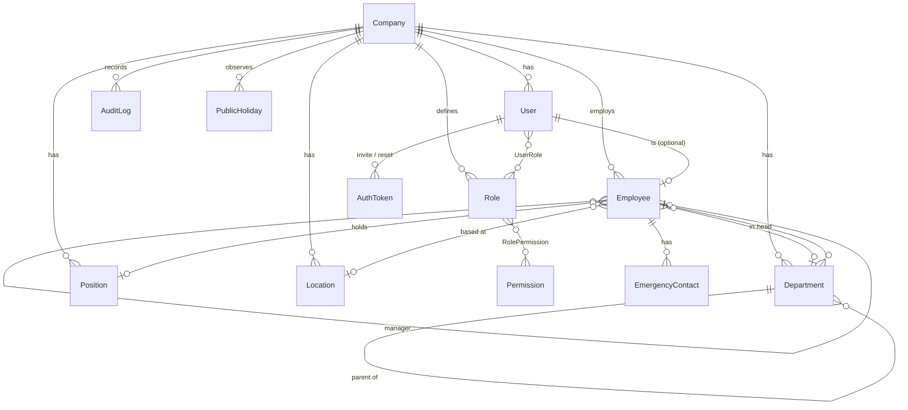

# HRMS — Architecture

Employee Management Portal for UAE-based companies. This document is the source of truth for the
stack, structure, data model and access model. It is updated at every checkpoint.

## 1. Stack

| Concern            | Choice                                                                    | Notes |
|--------------------|---------------------------------------------------------------------------|-------|
| Framework          | Next.js 15 (App Router), React 19, TypeScript `strict`                     | Server Components for reads, Server Actions for mutations |
| Database           | PostgreSQL 16 + Prisma 6 (migrations + seed)                               | Prisma 6 chosen over 7/8 (still RC / breaking config changes) |
| Auth               | Auth.js v5 (`next-auth@5` beta): Credentials + optional Google / Microsoft Entra ID | see §6 for the session model |
| Password hashing   | `bcryptjs` (cost 12)                                                       | pure JS: no native build step in Docker/CI |
| UI                 | Tailwind CSS v4 + shadcn/ui components (Radix primitives), `next-themes`   | components vendored in `src/components/ui` |
| Validation         | Zod 4 — every Server Action / route handler parses its input               | schemas in `src/lib/validation` shared with forms |
| i18n               | `next-intl` (no locale routing; locale from cookie) + `dir` on `<html>`    | `messages/en.json`; Arabic/RTL in Phase 4 |
| Jobs / cron        | `pg-boss` (Postgres-backed, no Redis) in a separate `worker` process       | |
| Email              | Nodemailer; `EMAIL_TRANSPORT=console` logs in dev, `smtp` → Mailpit/real SMTP | templates in `src/server/mail/templates` |
| PDF (Phase 3)      | `@react-pdf/renderer` (no headless browser needed in production image)     | |
| Tests              | Vitest (unit), Playwright (e2e)                                            | |
| Local dev          | Docker Compose: `app`, `worker`, `db` (Postgres 16), `mailpit`             | |

### Deviations from the brief
* **Session strategy.** Auth.js cannot persist database sessions for the Credentials provider. We use
  Auth.js' encrypted (JWE) session cookie, and make it behave like a server session:
  every request re-loads the user from the DB (`getAuthContext`) and rejects the session if the user is
  inactive/terminated or if `user.sessionVersion` no longer matches the cookie (bumped on logout-all,
  password change, role change, termination). Idle timeout = `SESSION_IDLE_MINUTES` (rolling cookie),
  absolute timeout = `SESSION_ABSOLUTE_HOURS`.
* **bcrypt instead of argon2**: avoids native modules; cost factor is configurable.
* **Login is by globally-unique email.** A user belongs to exactly one company. Multi-company users would
  need a company picker; out of scope.
* **shadcn/ui components are vendored by hand** in `src/components/ui` (same API/styling as the CLI output);
  form selects use a styled native `<select>` for accessibility and plain `FormData` submission.
* **Next.js 15 / Prisma 6** are pinned rather than the newest majors, which were still RC or had breaking
  configuration changes at the time of writing.

## 2. Folder structure

```
prisma/
  schema.prisma          # data model
  migrations/            # generated SQL migrations (committed)
  seed.ts                # demo company, roles/permissions, ~40 employees
  seed-data/             # deterministic seed fixtures
messages/en.json         # i18n strings
src/
  app/
    (auth)/              # login, forgot/reset password, invite acceptance, forced password change
    (app)/               # authenticated shell (sidebar + topbar)
      dashboard/ directory/ org-chart/ profile/
      employees/         # list, new, import, [id] (tabbed detail), [id]/edit, [id]/terminate
      organization/      # departments, positions, locations
      admin/             # roles, users, audit, company settings
    api/
      auth/[...nextauth] # Auth.js
      files/             # authenticated file streaming (photos, logos)
      employees/export   # CSV export
  components/
    ui/                  # shadcn/ui primitives
    layout/              # app shell, nav, theme toggle
    data-table/          # URL-driven table: search, sort, filters, pagination
    ...feature components
  lib/                   # isomorphic helpers: validation schemas, iban, masking, dates, money, cn()
  server/                # server-only code (imports `server-only`)
    db.ts                # Prisma client singleton
    auth/                # Auth.js config, password, tokens, rate limit, getAuthContext
    rbac/                # permission catalogue, role defaults, authorize helpers, team scope
    services/            # business logic (one file per aggregate); NO request objects here
    actions/             # thin Server Actions: parse (Zod) → authorize → service → revalidate
    audit.ts             # writeAudit()
    mail/                # mailer + templates
    storage/             # pluggable file storage (local disk now, S3 later)
    jobs/                # pg-boss queue definitions + handlers
  worker.ts              # job runner entrypoint
  i18n/                  # next-intl request config
tests/
  unit/                  # Vitest
  e2e/                   # Playwright
docs/                    # ARCHITECTURE.md, CHANGELOG.md
```

**Layering rule:** `page.tsx` / Server Actions / route handlers are thin. They call
`getAuthContext()` → `authorize()` → a service function that receives the `AuthContext` and validated
input. Services always filter by `ctx.companyId`. Client components never import from `src/server`.

## 3. Data model (Phase 1)



Key tables (see `prisma/schema.prisma` for every column):

| Table | Purpose / notable columns |
|-------|---------------------------|
| `Company` | name, logo, address, `currency` (ISO, default AED), `timezone` (default Asia/Dubai), `workWeek` (int[] ISO weekday 1=Mon…7=Sun, default 1–5), `fiscalYearStartMonth`, employee-number prefix/padding/sequence |
| `User` | login identity: email (unique), `passwordHash` (null until invite accepted), `mustChangePassword`, `isActive`, `sessionVersion`, `lastLoginAt` |
| `Role`, `Permission`, `RolePermission`, `UserRole` | DB-stored RBAC. Permissions are a global catalogue; roles are per company |
| `AuthToken` | hashed (SHA-256) single-use tokens: `INVITE`, `PASSWORD_RESET` with expiry |
| `LoginAttempt` | rate-limit + security trail (email, ip, success, time) |
| `Department` | self-referencing `parentId` (unlimited depth), `headId` → Employee, `costCenterCode` |
| `Position` | title, code, `grade`, `level` |
| `Location` | branches / sites |
| `Employee` | HR record (see brief), self-referencing `managerId`, `status` (ACTIVE / ON_LEAVE / TERMINATED), UAE identity docs, bank/IBAN, termination fields. Never hard-deleted |
| `EmergencyContact` | 0..n per employee |
| `AuditLog` | actor, action, entity, entityId, `before`/`after` JSON, ip, user agent |
| `PublicHoliday` | per company/year, optional location (management UI in Phase 2) |

Conventions:
* Every business table carries `companyId` (indexed) — single company today, never hard-coded.
* IDs are `cuid`. Timestamps are `timestamptz` in UTC. **Calendar dates** (DOB, join date, expiries,
  last working day) are `date` columns — they are not instants and must not shift with timezones.
* Money (Phase 3) will be `BigInt` minor units (fils) + company currency. Never float.
* Cycles: `Employee.managerId` and `Department.parentId` are validated in the service layer
  (walk the ancestor chain with a recursive CTE before writing).

## 4. Roles & permission matrix

Permissions are rows in `Permission`; seeded roles get the defaults below and are editable from
**Admin → Roles** (the system `SUPER_ADMIN` role is locked so nobody can lock themselves out).
A user can hold several roles; effective permissions are the union.

| Permission key | Super Admin | HR Admin | Payroll Admin | Manager | Employee |
|---|:-:|:-:|:-:|:-:|:-:|
| `company.settings.manage` | ✅ | | | | |
| `role.manage` | ✅ | | | | |
| `user.manage` (invite, reset, deactivate, assign roles) | ✅ | ✅ | | | |
| `audit.read` | ✅ | ✅ | | | |
| `org.manage` (departments, positions, locations) | ✅ | ✅ | | | |
| `employee.read.all` | ✅ | ✅ | ✅ | | |
| `employee.read.team` (direct + indirect reports) | ✅ | ✅ | | ✅ | |
| `employee.create` / `employee.update` | ✅ | ✅ | | | |
| `employee.terminate` | ✅ | ✅ | | | |
| `employee.import` | ✅ | ✅ | | | |
| `employee.export` | ✅ | ✅ | ✅ | | |
| `employee.sensitive.read` (IDs, passport, visa, IBAN unmasked) | ✅ | ✅ | ✅ | | |
| `directory.read` / `orgchart.read` | ✅ | ✅ | ✅ | ✅ | ✅ |
| `dashboard.hr` | ✅ | ✅ | | | |
| *Phase 2:* `leave.policy.manage`, `leave.request.read.all`, `leave.approve.team`, `leave.balance.adjust` | ✅ | ✅ | | team only | |
| *Phase 3:* `payroll.salary.manage`, `payroll.run.manage`, `payroll.run.approve`, `payroll.export`, `payslip.read.all` | ✅ | | ✅ | | |
| *Self-service* (own profile, own leave, own payslips) | implicit for any user linked to an employee | | | | |

Rules on role assignment (`user.manage`): only a Super Admin can grant/revoke Super Admin or
enable/disable a Super Admin; at least one active Super Admin must remain; non-Super-Admins cannot
change their own roles and can only grant roles whose permissions they already hold. A Manager role is
granted automatically when someone becomes the manager of an employee (never revoked automatically).

Data visible per relationship to an employee record:

| Viewer | Personal data | ID / passport / visa / IBAN | Emergency contacts | Tabs |
|---|---|---|---|---|
| Self | full | unmasked | yes (editable) | Overview, Job, Documents, Leave, Payroll |
| `employee.read.all` + `employee.sensitive.read` | full | unmasked | yes | all |
| `employee.read.all` only | full | masked | yes | Overview, Job, Documents, Leave |
| Manager (team member) | DOB/personal email/address hidden | masked | hidden | Overview, Job, Leave |
| Anyone else | directory card only (name, title, department, location, work email, manager) | — | — | — |

Enforcement:
1. **Server first.** Every Server Action, route handler and page loader calls
   `authorize(ctx, permission)` or a scoped check (`canViewEmployee(ctx, employeeId)` combines
   `employee.read.all`, `employee.read.team` + reporting-tree membership, and self).
2. **Data shaping.** Services return DTOs per audience — the directory DTO has no sensitive columns;
   sensitive columns are selected only when `employee.sensitive.read` is held, and are masked in lists.
3. The UI hides what the user cannot do, purely as UX.

## 5. Audit

`writeAudit(ctx, { action, entityType, entityId, before, after })` inside the same transaction as the
change, capturing IP / user agent from request headers. Audited: employees (create/update/terminate/import),
users & role assignments, roles/permissions, company settings, departments/positions/locations, and —
later — salary, leave approvals and payroll. Secrets (password hashes, token hashes) are stripped.

## 6. Authentication & sessions

* Credentials login (bcrypt) with rate limiting: max 5 failures / 15 min per email and 20 / 15 min per IP
  (DB-backed `LoginAttempt`, works across instances).
* Optional Google and Microsoft Entra ID providers, enabled only when their env vars are set. SSO only
  signs in **existing** users matched by verified email (no self-provisioning).
* Invite flow: HR creates employee → optional "send invite" → single-use token (72h) → set password.
* Forgot/reset: token valid 1h; response never reveals whether the email exists.
* First-login forced password change via `mustChangePassword` (enforced in the app layout and in
  `getAuthContext` for every action).
* Termination: when `lastWorkingDay` (company timezone) has passed, login is refused and existing
  sessions are invalidated; a daily job flips scheduled terminations to `TERMINATED`.

## 7. Security baseline

* Secure headers (CSP, HSTS in prod, X-Frame-Options DENY, nosniff, Referrer-Policy, Permissions-Policy)
  in `next.config.ts`.
* CSRF: Server Actions are POST-only with Next's built-in Origin/Host check; Auth.js routes use its CSRF
  token; our mutating route handlers verify `Origin`.
* Uploads: type sniffed from magic bytes (not the client MIME), size limits, random file names, stored
  outside `public/`, streamed through an authorised route.
* IBAN / Emirates ID / passport masked in lists and for non-privileged viewers.

## 8. Background jobs (pg-boss)

| Queue | Schedule | Phase |
|---|---|---|
| `employee.apply-terminations` | daily 00:15 company TZ | 1 |
| `email.send` | on demand — Phase 1 sends synchronously (failures are logged, never block the flow); moved to the queue with Phase 2 notifications | 2 |
| `leave.monthly-accrual`, `leave.year-end`, `leave.escalations` | cron | 2 |
| `documents.expiry-alerts` | daily | 4 |

## 9. Phase status

| Phase | Status |
|---|---|
| 1 Foundation | ✅ Checkpoint 1 — see CHANGELOG |
| 2 Leave | not started |
| 3 Payroll | not started |
| 4 Extras | not started |

## 10. Known limitations / follow-ups

* **403 pages return HTTP 200.** The `(app)/loading.tsx` skeleton streams the shell before the page calls
  `forbidden()`, so the status code can no longer change. The 403 UI renders and no data is sent; APIs return
  real 401/403 codes. Moving skeletons to per-segment `loading.tsx` files would restore the status codes.
* **i18n coverage.** Navigation, auth screens and common labels use `messages/en.json`; most page body
  copy is still inline English. Extraction happens with the Arabic/RTL work in Phase 4.
* **CSP** allows `'unsafe-inline'` scripts (Next.js inline bootstrap) — a nonce-based CSP via middleware is a
  hardening follow-up.
* **File storage** is local disk (`STORAGE_DIR`); the `Storage` interface is ready for an S3 implementation.
